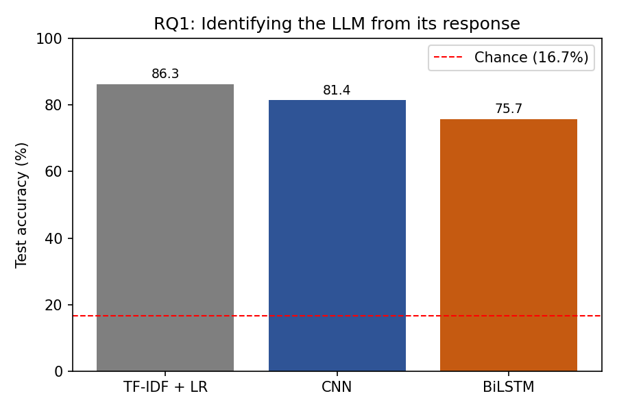
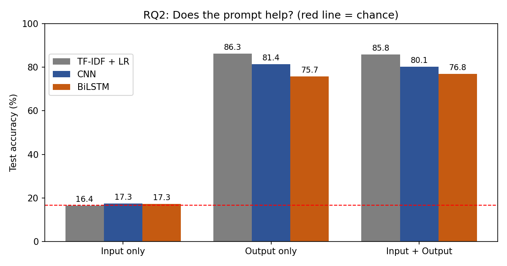
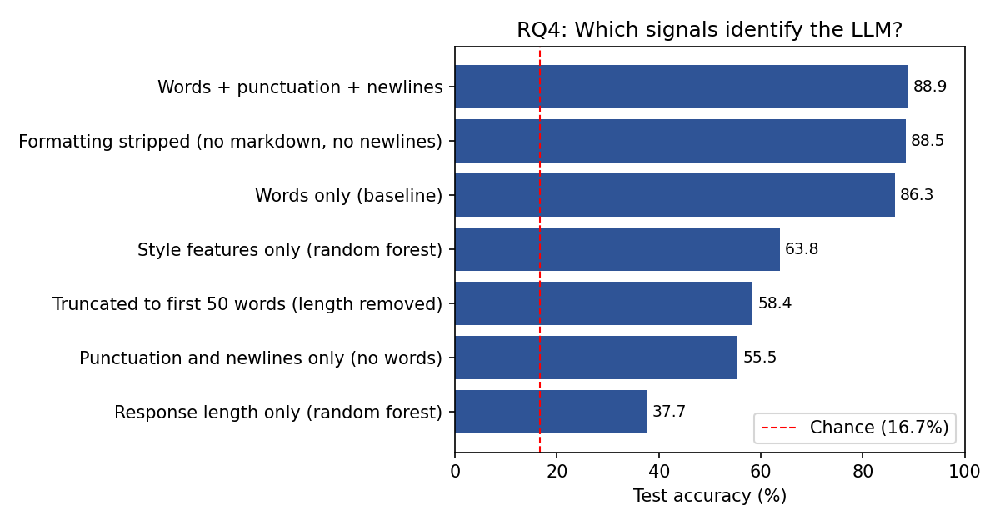
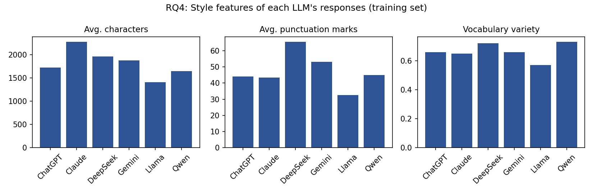
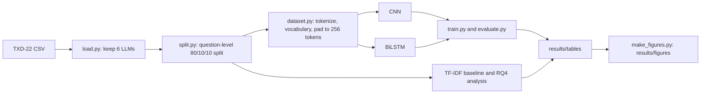

# Deep Learning Framework for LLM Source Attribution

**Who wrote it?** This project trains neural networks to identify which large language model (LLM) wrote a piece of text. It is the CMPSC 448 midterm project by Salman Asif, Chris Li and Surya Harikrishnan.

We classify responses from six LLM families (ChatGPT, Claude, Gemini, Llama, Qwen and DeepSeek) using two required models, a **CNN** and a **BiLSTM**, and compare them with a simple **TF-IDF + logistic regression** baseline. The full write-up is in [`report/report.pdf`](report/report.pdf).

## Research questions

| | Question | Short answer |
|---|---|---|
| **RQ1** | Can we identify which LLM generated a response? | Yes. 81.4% (CNN) and 75.7% (BiLSTM) accuracy, against 16.7% for random guessing. |
| **RQ2** | Does the user's prompt help? | No. The prompt alone is at chance level, and adding it to the response does not consistently help. |
| **RQ4** | What characteristics distinguish different LLMs? | Vocabulary carries most of the signal. Style features such as length, punctuation and vocabulary variety are also informative on their own. |

RQ3 (generalization across tasks) was not investigated, because the dataset has no task or domain labels.

## Results

All numbers are test-set accuracy and macro-F1 (in %) on the same question-level split. Chance level is 16.7%.

**Accuracy**

| Model | Input only | Output only | Input + Output |
|---|---|---|---|
| TF-IDF + logistic regression | 16.44 | **86.29** | 85.78 |
| CNN | 17.35 | 81.40 | 80.15 |
| BiLSTM | 17.29 | 75.71 | 76.85 |

**Macro-F1**

| Model | Input only | Output only | Input + Output |
|---|---|---|---|
| TF-IDF + logistic regression | 13.28 | 86.28 | 85.75 |
| CNN | 10.25 | 81.35 | 80.28 |
| BiLSTM | 12.46 | 75.92 | 77.00 |





**What this shows**
- The response text identifies the LLM well. The prompt alone tells us nothing, because the same questions were asked to almost every LLM.
- The simple TF-IDF baseline beats both neural networks. Word choice is very informative on this dataset.
- Run-to-run variation is about 1 point for the CNN and about 3 points for the BiLSTM, so small gaps between models or input settings should not be over-interpreted.

### RQ4: what makes the LLMs different?





- Claude writes the longest responses and Llama the shortest. DeepSeek uses the most punctuation.
- Responses are almost plain text, with very few line breaks or markdown symbols, so removing formatting changes accuracy by only 0.4 points.
- A classifier using only nine simple style features reaches 63.8%. Response length alone reaches only 37.7%.
- Truncating every response to 50 words drops accuracy to 58.4%. This removes both length and later content, so it cannot separate the two effects.

Details and tables are in section 4.4 of the report.

## How it works



1. **Load:** read the TXD-22 CSV, keep the six LLMs, and rename the columns to `input` (the question), `output` (the answer) and `label` (the LLM).
2. **Split:** 80/10/10 train, validation and test, grouped by question. This matters because the same question appears for most LLMs. A row-level split would put a question in both train and test and give misleading scores.
3. **Prepare text:** split text into words, punctuation and newlines, build a 30,000-token vocabulary from the training set, and pad or cut every text to 256 tokens.
4. **Train:** both networks use the same loop (Adam, learning rate 0.001, cross-entropy loss, batch size 64). The epoch with the best validation accuracy is kept and scored once on the test set.
5. **Input modes:** each experiment uses `input` (question only), `output` (answer only) or `both` (question and answer joined by a separator).

## Repository structure

```
.
├── README.md
├── requirements.txt
├── data/
│   ├── README.md            how to get the dataset
│   ├── raw/                 put the TXD-22 CSV here (not committed)
│   └── processed/           generated train/val/test CSVs (not committed)
├── src/
│   ├── data/
│   │   ├── load.py          read the CSV and keep the six LLMs
│   │   ├── split.py         create the question-level train/val/test split
│   │   └── dataset.py       tokenizer, vocabulary, PyTorch data loaders
│   ├── models/
│   │   ├── cnn.py           TextCNN (kernel sizes 3, 4, 5; 100 filters each)
│   │   ├── rnn.py           BiLSTM (128-dim embedding, 128 hidden units)
│   │   └── baselines.py     TF-IDF + logistic regression baseline
│   ├── train.py             shared training loop used by both networks
│   ├── evaluate.py          accuracy, macro-F1 and confusion matrix
│   └── utils.py             random seeding
├── scripts/
│   └── train_cnn.py         CNN on output only (prints the result)
├── experiments/
│   ├── rq2_input_vs_output.py     CNN on input only and on both
│   ├── bilstm_runs.py             BiLSTM on output, input and both
│   ├── rq4_feature_analysis.py    style features, ablations, top words
│   └── make_figures.py            draw the figures from the saved results
├── results/
│   ├── tables/              saved result files (CSV and JSON)
│   └── figures/             charts used in this README and the report
└── report/
    ├── report.pdf           final project report
    └── cnn_summary.md       notes on the CNN implementation
```

## Getting started

**1. Install**
```bash
git clone https://github.com/SuryaHarikrishnan/Deep-Learning-Framework-for-LLM-Source-Attribution
cd Deep-Learning-Framework-for-LLM-Source-Attribution
python -m venv .venv
source .venv/bin/activate        # Windows: .venv\Scripts\activate
pip install -r requirements.txt
```

**2. Get the data.** Download [TXD-22](https://www.kaggle.com/datasets/mdsadiqiqbal/txd-22-a-large-scale-benchmark-dataset) from Kaggle and place `TXD-22 A Large-Scale Benchmark Dataset.csv` in `data/raw/`. The file is latin-1 encoded, and the loader already handles that.

**3. Create the splits** (takes a few seconds)
```bash
python -m src.data.split
```
This prints 3,000 rows per LLM and writes `train.csv`, `val.csv` and `test.csv` to `data/processed/`. Expected sizes are about 14,448 / 1,794 / 1,758.

Run every command from the repository root.

## Running the experiments

| Command | What it does | Saves | Time |
|---|---|---|---|
| `python -m src.models.baselines` | TF-IDF baseline, all three input modes | `baseline_tfidf.csv` | about 1 minute |
| `python -m scripts.train_cnn` | CNN on output only (RQ1) | prints accuracy and macro-F1 (a saved copy is `cnn_results.json`) | a few minutes on CPU |
| `python -m experiments.rq2_input_vs_output` | CNN on input only and on both (RQ2) | `rq2_results.json` | a few minutes on CPU |
| `python -m experiments.bilstm_runs` | BiLSTM on output, input and both (RQ1 and RQ2) | `bilstm_results.json` | very slow on CPU, use a GPU |
| `python -m experiments.rq4_feature_analysis` | RQ4 style features, ablations and top words | `rq4_*.csv` | about 2 minutes |
| `python -m experiments.make_figures` | redraw all figures from the saved results | `results/figures/*.png` | seconds |

All result files are written to `results/tables/`.

**Using a free GPU on Google Colab.** The BiLSTM is slow on a CPU. In a new Colab notebook, switch the runtime to a GPU, then run:
```python
!git clone https://github.com/SuryaHarikrishnan/Deep-Learning-Framework-for-LLM-Source-Attribution
%cd Deep-Learning-Framework-for-LLM-Source-Attribution
# upload the dataset zip with the file panel, then:
!unzip -o /content/archive.zip -d data/raw/
!python -m src.data.split
!python -m experiments.bilstm_runs
```

## Train your own model

Any model that takes a `(batch, 256)` tensor of token ids and returns `(batch, 6)` class scores works with the shared pipeline:

```python
from src.data.dataset import get_loaders
from src.models.cnn import TextCNN
from src.train import run
from src.utils import set_seed

# mode can be "input", "output" or "both"
train_loader, val_loader, test_loader, vocab, labels = get_loaders("output")

set_seed(42)  # seed before building the model so the starting weights repeat
model = TextCNN(len(vocab), len(labels))

print(run(model, train_loader, val_loader, test_loader, labels, epochs=10))
```

`run` returns a dictionary with `accuracy` and `macro_f1`. Pass `fig_path="cm.png"` to also save a confusion matrix.

## Reproducibility notes

- The split and the TF-IDF and RQ4 results are deterministic with seed 42.
- Neural network results vary a little between runs. The model must be seeded before it is built, not only inside `run`. The saved BiLSTM results come from the seeded script `bilstm_runs.py` run once on a Google Colab GPU. The saved CNN output-only result (81.40%) comes from the committed `cnn_results.json`, and other runs of that experiment ranged from about 80.4% to 81.7%.
- Data files are not committed. Download the dataset and run `src.data.split` to recreate them.

## Limitations

- Inputs are cut to 256 tokens, which can remove content from long responses.
- The CNN was trained for 10 epochs and the BiLSTM for 20, so the comparison between them is not fully controlled.
- Each result comes from a single training run.
- RQ4 uses simple features and a TF-IDF model, so it shows which signals exist in the data but not exactly which ones the neural networks use.
- The six LLMs come from one dataset, and we did not test unseen LLMs or other datasets.

## Team

- **Surya Harikrishnan:** data pipeline and shared training code, TF-IDF baseline, BiLSTM runs, RQ4 analysis, report
- **Salman Asif:** CNN model and CNN experiments
- **Chris Li:** BiLSTM model